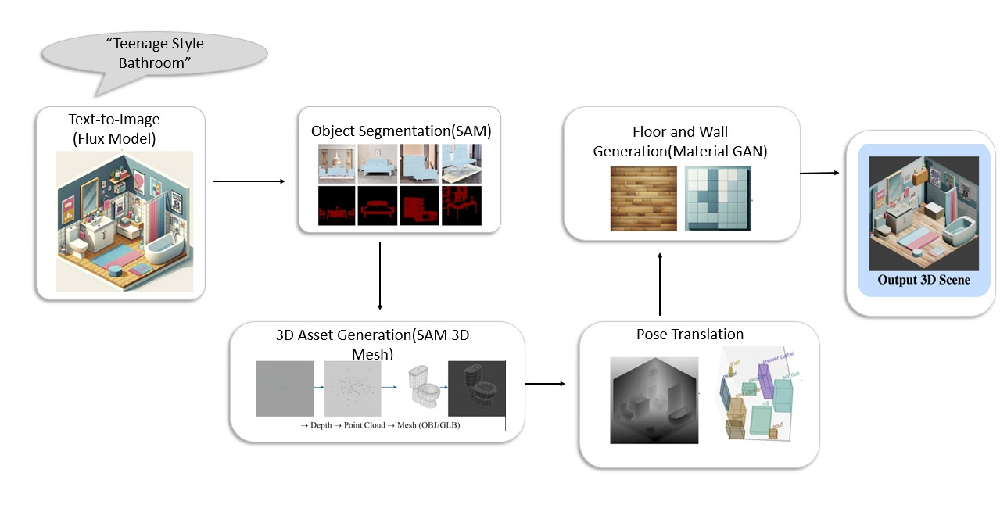

# Context-Aware Text-to-3D Scene Generation for Indoor Environments

An end-to-end multi-stage pipeline for synthesizing spatially coherent, collision-free 3D indoor environments from natural language descriptions.

---

## 📌 Overview

This project implements a modular, six-stage generative architecture that converts a natural language prompt into an editable 3D indoor scene. Rather than relying on monolithic text-to-3D models that suffer from geometry distortions and view inconsistency, this system decouples the synthesis into specialized foundation stages:

1. **2D Scene Layout Generation** (FLUX.1 Diffusion Transformer)
2. **Object Segmentation** (Segment Anything Model - SAM)
3. **3D Asset Reconstruction** (SAM-3D / Monocular Depth-to-Mesh Lifting)
4. **6D Pose Translation & Layout Optimization** (Collision-Aware Spatial Alignment)
5. **Environment Texturing** (MaterialGAN / SVBRDF PBR Maps)
6. **Scene Composition & Rendering** (Blender `bpy` & Unity Engine)

---

## 🔄 System Pipeline



### Processing Stages
| Stage | Module | Input | Output | Description |
|---|---|---|---|---|
| **1** | Text-to-Image | Text Prompt | 2D Scene Layout (1024×1024) | High-fidelity isometric/top-down scene synthesis via FLUX |
| **2** | Object Segmentation | 2D Scene Image | Binary Masks & RGBA Cutouts | Pixel-precise object isolation using SAM |
| **3** | Asset Reconstruction | Object Masks + RGB | 3D Meshes (`.obj` / `.glb`) | Monocular depth estimation and watertight mesh generation |
| **4** | Pose & Layout | 3D Meshes + 2D BBoxes | `scene_graph.json` | 6D pose estimation and collision-free spatial alignment |
| **5** | Material Synthesis | Scene Prompts / Patches | PBR Maps (Albedo, Normal, ORM) | Seamless SVBRDF materials for walls and floors |
| **6** | Scene Composition | Assets + Layout JSON | Assembled 3D Environment | Final isometric render in Blender / Unity |

---

## 📁 Repository Structure

```text
context-aware-text-to-3d-scene-generation/
│
├── scene_graph_sample.json       # Canonical 3D scene graph definition
├── requirements.txt              # Python package dependencies
├── environment.yml               # Conda environment configuration
│
├── notebooks/
│   └── pipeline_walkthrough.ipynb # Colab-ready interactive step-by-step walkthrough
│
├── src/                          # Modular Python source code
│   ├── config.py                 # Paths, hardware detection, model IDs
│   ├── 01_text_to_image.py       # Module 1: FLUX 2D image synthesis
│   ├── 02_segmentation.py        # Module 2: SAM automatic mask extractor
│   ├── 03_asset_reconstruction.py# Module 3: 2D-to-3D mesh lifting
│   ├── 04_pose_and_scene_graph.py# Module 4: 6D pose & collision resolution
│   ├── 05_material_generation.py # Module 5: PBR texture map generator
│   ├── 06_blender_compose.py     # Module 6: Headless Blender (bpy) renderer
│   └── pipeline.py               # Master end-to-end CLI orchestrator
│
├── 1.Text_to_Image/              # Stage 1: Generated 2D intermediate scenes
├── 2.Barbie_bath_mask/           # Stage 2: Segment Anything (SAM) object masks
├── 3.Sam_Output/                 # Stage 3: Isolated object cutouts & 3D inputs
├── 4.Pose_Estimation/            # Stage 4: 3D bounding boxes & pose alignments
├── 5.Material_Generation/        # Stage 5: PBR material texture channels
└── 6.Final_Results/              # Stage 6: Final rendered 3D scenes
```

---

## ⚡ Quickstart & Installation

### Option 1: Conda Environment (Recommended)
```bash
# Clone the repository
git clone https://github.com/Aishwarya095/context-aware-text-to-3d-scene-generation.git
cd context-aware-text-to-3d-scene-generation

# Create and activate environment
conda env create -f environment.yml
conda activate text2scene3d
```

### Option 2: Pip Installation
```bash
pip install -r requirements.txt
```

---

## 🚀 Running the Pipeline

### 1. Run the Full End-to-End Pipeline
```bash
python src/pipeline.py --prompt "Isometric view of a modern aesthetic bathroom with pastel teal walls, ceramic bathtub, washbasin, mirror, and commode" --room_type bathroom
```

### 2. Run Individual Modules
* **Step 1: Generate 2D Scene Layout**
  ```bash
  python src/01_text_to_image.py --prompt "Top down view of a modern kitchen with central island and refrigerator"
  ```
* **Step 2: Segment Objects with SAM**
  ```bash
  python src/02_segmentation.py --image outputs/01_scene_layout.png
  ```
* **Step 3: Reconstruct 3D Meshes**
  ```bash
  python src/03_asset_reconstruction.py --meta outputs/masks/segmentation_metadata.json
  ```
* **Step 4: Compute 6D Poses & Build Scene Graph**
  ```bash
  python src/04_pose_and_scene_graph.py --assets_meta outputs/assets/assets_metadata.json --room_type bathroom
  ```
* **Step 5: Generate PBR Materials**
  ```bash
  python src/05_material_generation.py
  ```
* **Step 6: Render in Blender (Headless)**
  ```bash
  blender --background --python src/06_blender_compose.py -- --scene_json outputs/scene_graph.json --out outputs/final_render.png
  ```

---

## 🖼️ Results Gallery

* **Stage 1 (Text-to-Image Generation):** [1.Text_to_Image/](1.Text_to_Image/)
* **Stage 2 (Object Segmentation Masks):** [2.Barbie_bath_mask/](2.Barbie_bath_mask/)
* **Stage 3 (SAM 3D Object Assets):** [3.Sam_Output/](3.Sam_Output/)
* **Stage 4 (Spatial Pose Estimation):** [4.Pose_Estimation/](4.Pose_Estimation/)
* **Stage 5 (PBR Material Generation):** [5.Material_Generation/](5.Material_Generation/)
* **Stage 6 (Final 3D Scene Compositions):** [6.Final_Results/](6.Final_Results/)

---

## 🔗 External Research & References

* **ArtiScene (CVPR 2025):** [NVLabs/ArtiScene](https://github.com/NVLabs/ArtiScene)
* **Segment Anything Model (SAM):** [facebookresearch/segment-anything](https://github.com/facebookresearch/segment-anything)
* **SAM 3D Objects:** [facebookresearch/sam-3d-objects](https://github.com/facebookresearch/sam-3d-objects)
* **Any6D (CVPR 2024):** [taeyeopl/Any6D](https://github.com/taeyeopl/Any6D)
* **FLUX.1:** [Black Forest Labs](https://blackforestlabs.ai/)
